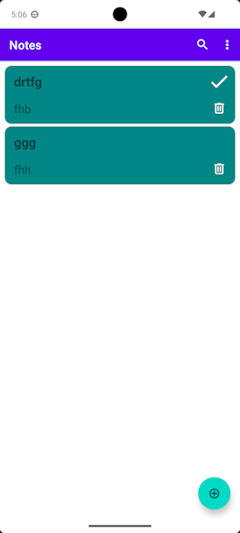

# About

The Android app "Notes" for phones and tablets.

## Used technologies

- Kotlin, Coroutines and Flow
- ViewModel and LiveData
- Room
- DataStore (Preferences)
- Navigation component
- Data Binding
- JUnit

## Current functionality

- create and edit a note with a title and a body
- mark a note as completed
- set a note background in the list of notes (for each note separately, from the edit note screen)
- set the background and the text color of the edit note screen (for all notes at the same time, in Settings)
- change the font size (for all notes at the same time, in Settings)
- search notes by title and body
- delete a note from the list of notes
- delete a note from the edit note screen
- dark mode

# To do

- [x] add item complete mark in item view (item_note)
- [x] use the DataStore instead of the SharedPreferences
- [ ] item creation date and item change date as a part of view (item_note)
- [x] add dark mode support (change vector icons color for better look in dark mode)

> **Note:** if you are installing a new version of the application, please uninstall the previous version manually.

